# Monitor sísmico global: sismos del USGS con estimación de impacto


Un tablero que sigue casi en tiempo real los sismos del mundo de magnitud 4,5 o más. Un backend en **FastAPI** consulta el catálogo del **USGS** cada 3 minutos, guarda cada evento en **MariaDB**, estima su impacto (muertes, heridos, pérdidas y nivel de destrucción) y avisa al navegador por **WebSocket**. La interfaz en **Next.js** lo muestra como mapa, tarjetas de resumen, gráficos y tabla, y un cliente móvil en **Expo** muestra los mismos datos.

> English: [README.md](README.md)

El backend y la primera interfaz son obra mía (2025). Esta rama es un rediseño de la interfaz, del cliente móvil y de la estimación que hay detrás: [qué cambió](#antes-y-después) y [decisiones](docs/decisiones.md).

## Antes y después

| Antes | Después |
|---|---|
| 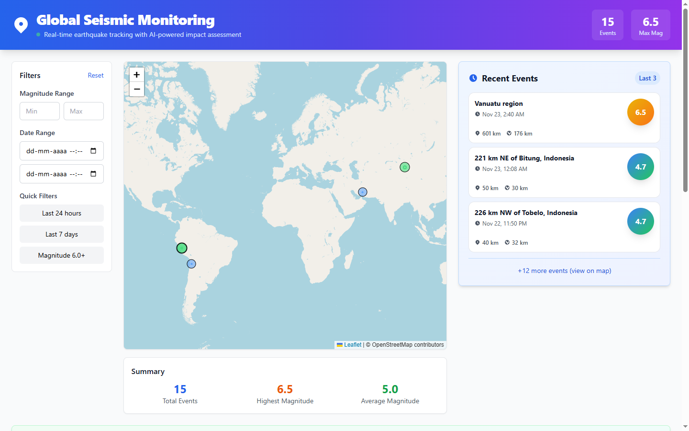 | 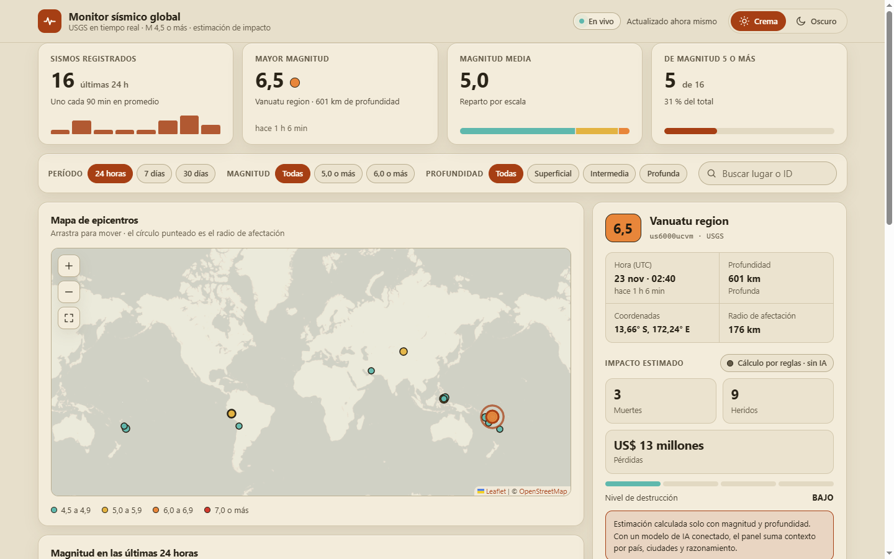 |

La interfaz original tenía degradados azul y morado sobre fondo blanco, estaba en inglés, dejaba un hueco en blanco bajo el mapa y, en el celular, los filtros llenaban la primera pantalla. Detrás, la estimación que se usa cuando no hay modelo de IA (lo habitual sin token) daba **150 muertes para un sismo de magnitud 6,5 a 601 km de profundidad**: casi ignoraba la profundidad.

## Qué demuestra este proyecto

| Habilidad | Dónde mirar |
|---|---|
| Backend asíncrono con FastAPI y SQLAlchemy 2.0, una tarea periódica y un WebSocket | [`backend/app/main.py`](backend/app/main.py), [`backend/app/routes/`](backend/app/routes) |
| Llamar a un LLM para obtener JSON estructurado, con una estimación de respaldo por reglas que es una función pura y probada | [`backend/app/inference/huggingface_client.py`](backend/app/inference/huggingface_client.py), [`backend/app/services/respaldo.py`](backend/app/services/respaldo.py) |
| Modelo de datos en MariaDB: eventos e impactos por país | [`backend/app/models/seismic_event.py`](backend/app/models/seismic_event.py), [`backend/init.sql`](backend/init.sql) |
| Diseño de interfaz: dos temas de color a partir de variables (un crema atenuado y un oscuro cálido), sin degradados | [`frontend/src/app/globals.css`](frontend/src/app/globals.css) |
| Un mapa Leaflet cuyas teselas siguen el tema, en React con props tipadas | [`frontend/src/components/SeismicMap.tsx`](frontend/src/components/SeismicMap.tsx) |
| Visualización de datos en SVG propio (sin librería de gráficos) | [`frontend/src/components/Charts.tsx`](frontend/src/components/Charts.tsx) |
| Lógica de la interfaz como funciones puras con pruebas (filtros, orden, resúmenes, CSV) | [`frontend/src/lib/seismic.ts`](frontend/src/lib/seismic.ts), [`frontend/tests/`](frontend/tests) |
| Accesibilidad: contraste de texto de al menos 4,5:1 medido por script en los dos temas, uso completo con teclado | [`tools/capturas/verificar_ui.js`](tools/capturas/verificar_ui.js) |
| Un cliente móvil en Expo (React Native): cuatro pestañas y una pantalla de detalle, los mismos temas, alertas en vivo por WebSocket y la dirección de la API calculada por una función probada en lugar de escrita en el código | [`mobile/`](mobile) |
| Docker Compose con base de datos con chequeo de salud | [`docker-compose.yml`](docker-compose.yml) |
| Pruebas: 36 en Python (`pytest`), 20 en la interfaz web y 30 en el cliente móvil (`node:test`; 20 de ellas vuelven a correr las pruebas de lógica de la web contra la copia del móvil), chequeo de tipos y compilaciones de producción | [`backend/tests/`](backend/tests), [`frontend/tests/`](frontend/tests), [`mobile/tests/`](mobile/tests) |

## Pantallas


| | |
|---|---|
| 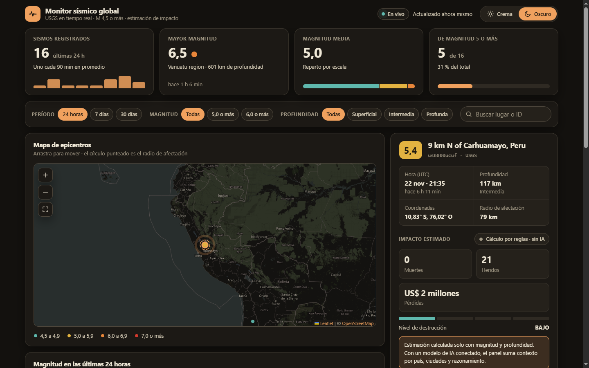 | 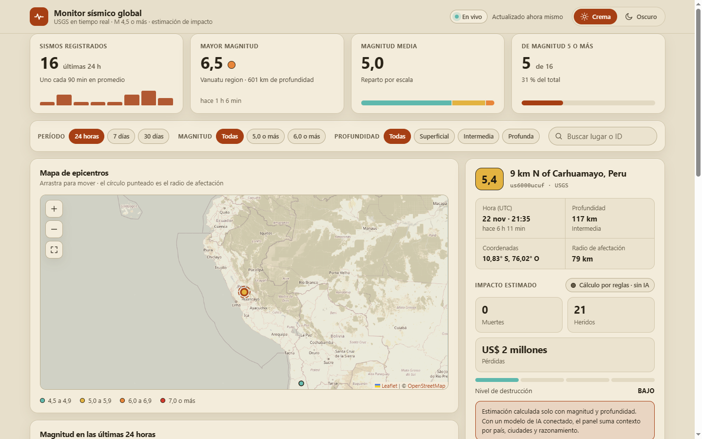 |
| 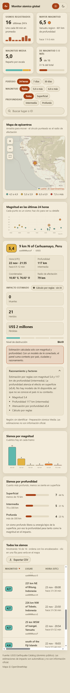 | 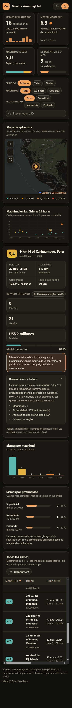 |

### Cliente móvil (Expo)

| | | |
|---|---|---|
| 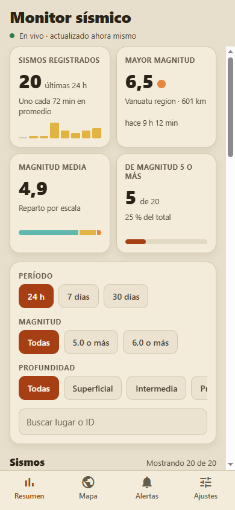 | 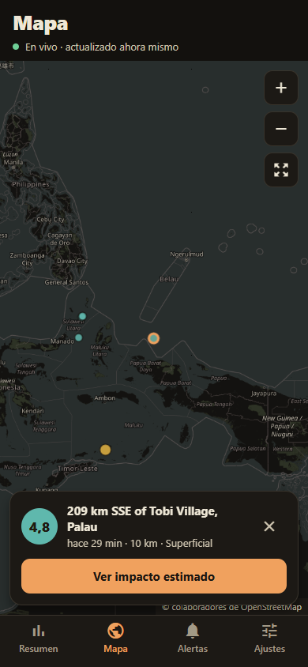 | 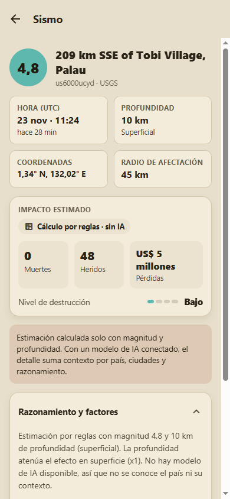 |

Son la versión de la app en el navegador (`expo start --web`) con datos reales; el mapa nativo y el comportamiento táctil no se han comprobado en un teléfono. [Detalles y límites](mobile/README.md) (en inglés).

El diseño se prototipó primero como una página HTML interactiva con los mismos eventos reales: [`docs/prototipo_visual.html`](docs/prototipo_visual.html) (descárgala y ábrela en un navegador). Un recorrido de 2,5 minutos (subtítulos en español, sin voz): [ver en YouTube](https://youtu.be/45RhoPXFj9A) ([English version](https://youtu.be/scIQnkal5zQ)). Las capturas son instantáneas de datos en vivo del 23 de noviembre de 2026.

## Inicio rápido

Requisitos: Docker con Compose.

```powershell
git clone https://github.com/Katapentakill/earthquake-impact-ai.git
cd earthquake-impact-ai
copy .env.example .env        # y cambia las dos contraseñas de la base de datos
docker compose up -d db backend frontend
```

Abre **http://localhost:3000**. La API queda en http://localhost:8000 (documentación interactiva en `/docs`). Los primeros eventos aparecen en menos de un minuto, cuando el backend ya consultó al USGS.

- `docker-compose.yml` también define un servicio `mobile` (Expo) para el cliente del celular (pon `LAN_IP` en `.env`, ver [DEPLOYMENT.md](DEPLOYMENT.md)); no forma parte de los comandos de arriba. La forma más simple de probar el cliente móvil es `npx expo start` dentro de [`mobile/`](mobile/README.md): la app encuentra la API sola.
- `NEXT_PUBLIC_API_URL` debe ser una dirección que **el navegador** pueda alcanzar (`http://localhost:8000`). `http://backend:8000` solo existe dentro de la red de Docker.
- Si el puerto 8000 está ocupado, publica el backend en otro y ajusta `NEXT_PUBLIC_API_URL` y `CORS_ORIGINS` en consecuencia.

### El modelo de IA (opcional)

Sin token de Hugging Face la app funciona y toda estimación sale de las reglas de respaldo; el panel lo dice («Cálculo por reglas · sin IA»). Para usar el modelo, crea un token con el preset **Inference** («Make calls to Inference Providers») en huggingface.co/settings/tokens y ponlo en `.env` como `HUGGINGFACE_API_TOKEN`.

El modelo por defecto es `meta-llama/Llama-3.3-70B-Instruct`. El original, `Qwen/Qwen2.5-7B-Instruct`, ya no lo sirve ningún proveedor de Inference Providers (comprobado el 23 de noviembre de 2026), así que el modelo debe estar en https://router.huggingface.co/v1/models. Comparé Qwen2.5-72B y Llama-3.3-70B con tres sismos: los dos devolvieron JSON válido todas las veces; Llama tardó de 5 a 14 segundos por respuesta (Qwen, de 11 a 13), lo sirven muchos más proveedores y, al pedírselo, escribió el razonamiento en español. El panel dice entonces «Análisis con IA»:

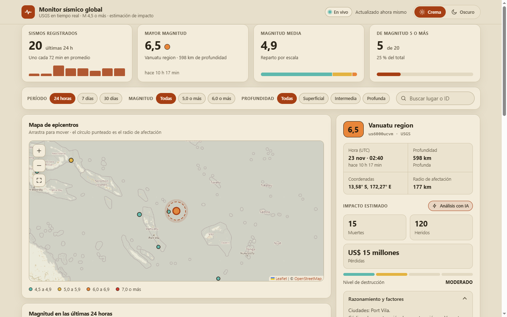

## Cómo funciona

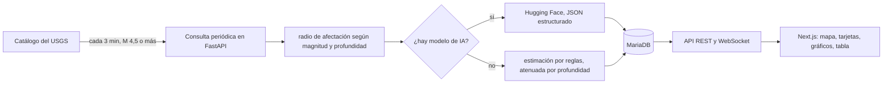

1. **Ingesta.** Una tarea en segundo plano pide al USGS los eventos nuevos de magnitud 4,5 o más.
2. **Radio.** El radio afectado crece con la magnitud y baja con la profundidad (acotado entre 10 y 5.000 km).
3. **Estimación.** Con modelo, responde en JSON con el detalle por país y su razonamiento. Sin modelo, `estimacion_respaldo` escala muertes, heridos y pérdidas según la clase de profundidad (superficial, intermedia, profunda) y baja el nivel de destrucción si el sismo no es superficial.
4. **Almacenamiento.** Los eventos y los impactos por país van a MariaDB; `GET /api/events/` devuelve además el nivel más alto de cada evento, las sumas y si la estimación salió de reglas o de la IA.
5. **En vivo.** Los eventos nuevos se anuncian por WebSocket y la página recarga su lista; también la recarga cada 3 minutos.

| Endpoint | Qué devuelve |
|---|---|
| `GET /api/events/` | Eventos, con filtros (`limit`, `min_magnitude`, `max_magnitude`, `start_date`, `end_date`) y un resumen de impacto cada uno |
| `GET /api/events/{id}` | Un evento con sus impactos por país |
| `GET /api/events/stats/summary` | Totales de los últimos N días |
| `POST /api/events/process` | Consulta al USGS ahora mismo |
| `WS /ws` | Avisos de eventos nuevos |
| `GET /health` | Estado de la consulta periódica |

## Pruebas

```powershell
cd frontend
npm test                # 20 pruebas de la lógica de la interfaz (Node 22.6 o superior)
npm run typecheck       # TypeScript
npm run build           # compilación de producción
cd ..\backend
pip install -r requirements-dev.txt
python -m pytest        # 36 pruebas: la estimación, el resumen de impactos y la lectura de la respuesta de la IA
cd ..\mobile
npm install
npm test                # 30 pruebas del cliente móvil (lógica compartida, resolvedor de direcciones, ajustes)
npx tsc --noEmit        # TypeScript
```

`tools/capturas/verificar_ui.js` corre sobre la app encendida: saca las pantallas en los dos temas y en celular, prueba filtros, orden, búsqueda y selección con teclado, y mide el contraste de todo el texto visible (`npm run ui --prefix tools/video`, después de `npm install --prefix tools/video`). En la última corrida: 0 fallos de unos 290 textos por pantalla, en crema, oscuro y celular.

`tools/capturas/verificar_movil.js` hace lo mismo con el cliente móvil corriendo en el navegador (`npm run movil --prefix tools/video`): cada pantalla en los dos temas a 390×844, filtros y navegación, y el contraste de cada texto; en la última corrida, 0 fallos de 770 textos y sin errores de consola.

GitHub Actions está configurado en [`.github/workflows/ci.yml`](.github/workflows/ci.yml), pero al momento de escribir esto la cuenta de la dueña o dueño del repositorio tiene un problema de facturación que detiene las ejecuciones, así que no hay insignia de CI: las suites de arriba se corrieron en local.

## Límites, con honestidad

- **Las estimaciones no son datos oficiales.** Las producen reglas o un modelo de lenguaje a partir de magnitud, profundidad y ubicación; no se validaron contra reportes reales de víctimas. Sin modelo no se conoce el país.
- **Las reglas son deliberadamente simples.** Las clases de profundidad y sus factores (1, 0,4, 0,02) son decisión mía, no sismología.
- **La IA y las reglas no coinciden, y ninguna está validada.** Para el sismo de magnitud 6,5 a 598 km la IA estimó 15 muertes (un modelo de 70B, una corrida, 23 de noviembre de 2026) y las reglas 3. Ninguna se comparó con reportes reales de víctimas, y un modelo de lenguaje puede citar hechos que no verificó (escribió «similar al terremoto de 2010 en Vanuatu» sin fuente). El camino con IA se ejecutó con tres sismos y dos modelos, y una vez de punta a punta por la consulta periódica y la interfaz; no ha corrido por mucho tiempo, y los créditos gratuitos de Inference Providers son limitados.
- **Los nombres de lugar vienen del USGS, en inglés** («221 km NE of Bitung, Indonesia»).
- **Las teselas del mapa son de OpenStreetMap.** Sirven para desarrollo; un despliegue público debería usar un proveedor con sus propios términos.
- **La lista de conexiones WebSocket vive en la memoria de un solo proceso**, así que no escala a varias réplicas del backend.
- **El cliente móvil se comprobó en un navegador y se compiló para Android e iOS, pero nunca se abrió en un teléfono.** No se han visto su mapa nativo, sus gestos ni su rendimiento; ver [sus límites](mobile/README.md#honest-limits). Las alertas son en vivo solo con la app abierta (sin notificaciones push).
- La interfaz está solo en español.

## Mapa del repositorio

| Ruta | Qué es |
|---|---|
| `backend/app/` | App FastAPI: rutas, modelos, servicios (USGS, radio, procesamiento, estimación por reglas, resumen de impactos), cliente de Hugging Face |
| `backend/tests/` | Pruebas pytest de las funciones puras |
| `frontend/src/` | Interfaz Next.js: `app/` (página y estilos), `components/`, `lib/` (lógica, formatos, hooks) |
| `frontend/tests/` | Pruebas `node:test` |
| `mobile/` | Cliente móvil Expo: `app/` (pantallas), `components/`, `lib/` (datos, resolvedor de direcciones, lógica copiada de la web), `tests/` |
| `tools/capturas/`, `tools/video/` | Verificación de la interfaz con auditoría de contraste, y el kit de video |
| `docs/` | Decisiones, lista estética, guion y guía del video, prototipo de diseño, capturas |

Más: [decisiones](docs/decisiones.md) · [lista estética](docs/pendientes_esteticos.md) · [guion del video](docs/video_guion.md) · [guía del video](docs/guia_video.md) · [cliente móvil](mobile/README.md) · [despliegue](DEPLOYMENT.md).

## Créditos

Diseño, backend, interfaz, pruebas y documentación: **Alexander Tapia**. Datos de sismos: [USGS Earthquake Catalog](https://earthquake.usgs.gov/) (dominio público). Mapa: © colaboradores de [OpenStreetMap](https://www.openstreetmap.org/copyright), dibujado con [Leaflet](https://leafletjs.com/).

## Licencia

[MIT](LICENSE).
