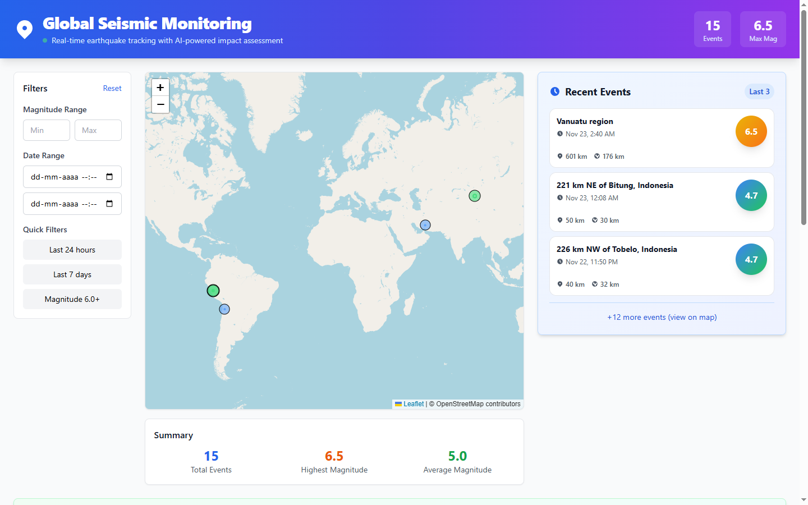
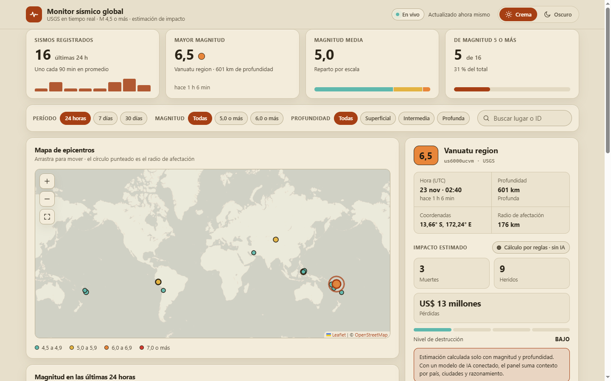
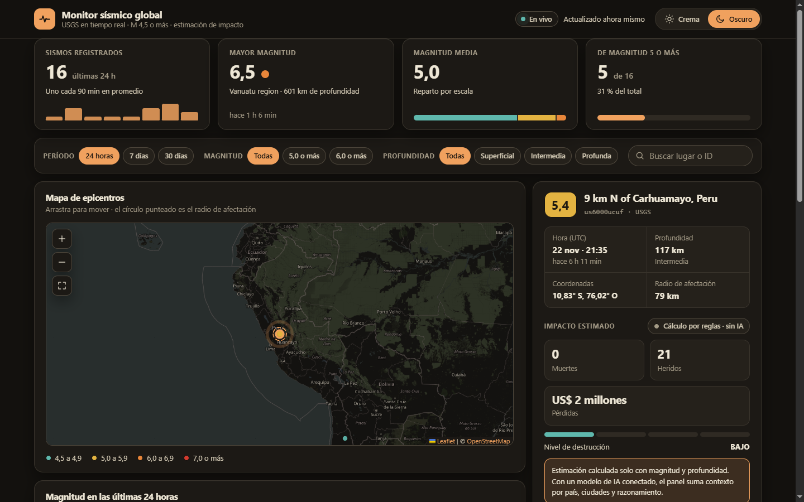
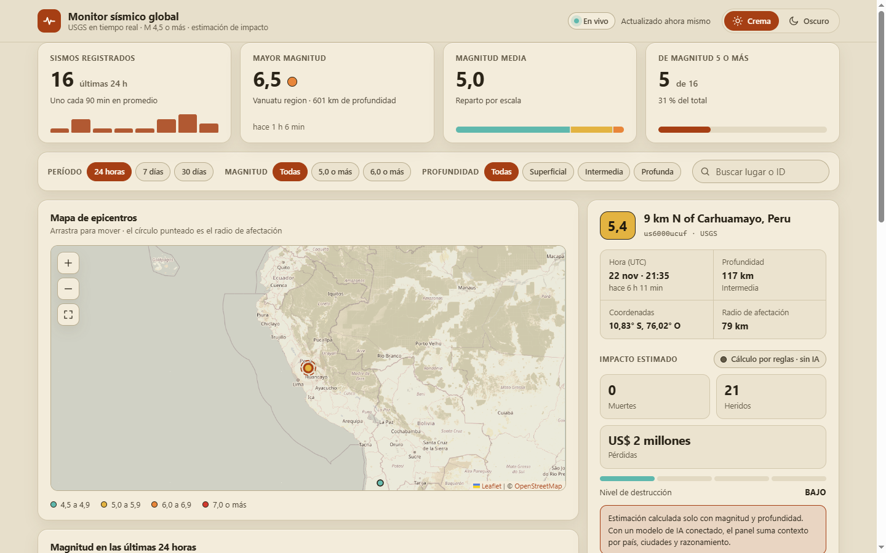
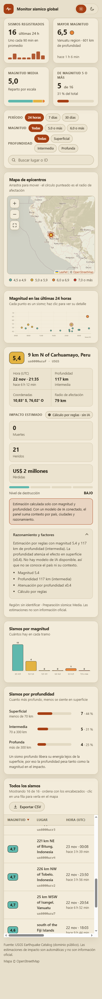
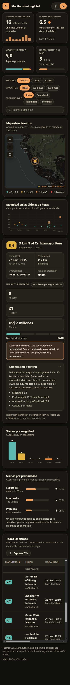
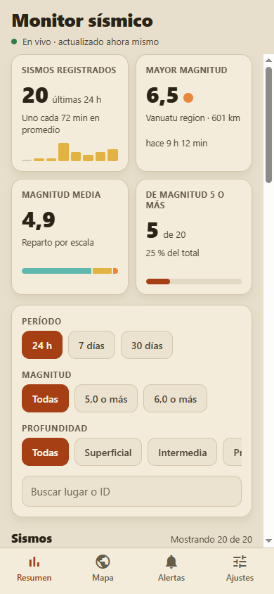
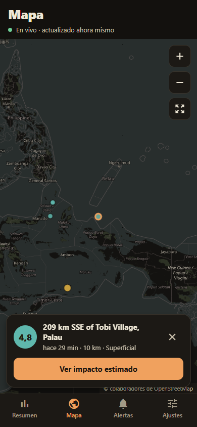
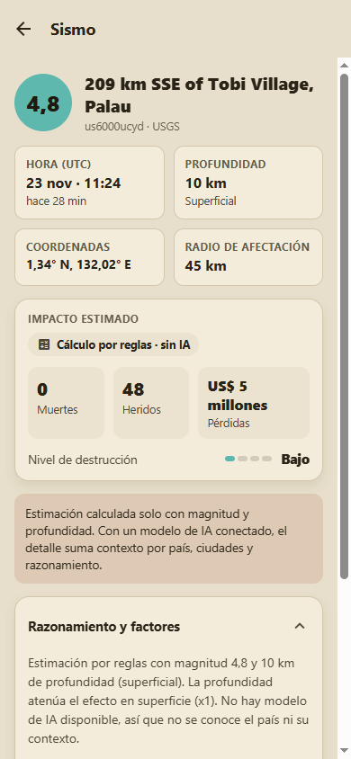
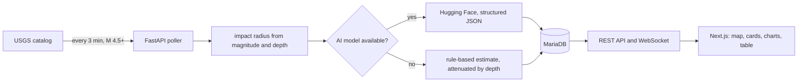

# Global seismic monitor: USGS earthquakes with an impact estimate


A dashboard that follows the world's earthquakes of magnitude 4.5 or more in near real time. A **FastAPI** backend polls the **USGS** catalog every 3 minutes, stores each event in **MariaDB**, estimates its impact (deaths, injured, losses, destruction level) and pushes news to the browser over a **WebSocket**. The **Next.js** interface shows it as a map, summary cards, charts and a table, and an **Expo** phone client shows the same data.

> Español: [README.es.md](README.es.md)

The backend and the first interface are my own work (2025). This branch is a redesign of the interface, of the phone client and of the estimate that sits behind them: [what changed](#before-and-after) and [decisions](docs/decisiones.md).

## Before and after

| Before | After |
|---|---|
|  |  |

The original interface had blue and purple gradients on a white background, was in English, left a blank gap under the map and, on a phone, filled the first screen with filters. Behind it, the estimate used when no AI model is available (the usual case without a token) gave **150 deaths for a magnitude 6.5 quake 601 km deep**; it ignored depth almost entirely.

## What this project demonstrates

| Skill | Where to look |
|---|---|
| Asynchronous backend with FastAPI and SQLAlchemy 2.0, a background polling task and a WebSocket | [`backend/app/main.py`](backend/app/main.py), [`backend/app/routes/`](backend/app/routes) |
| Calling an LLM for structured output (JSON) with a rule-based fallback that is a pure, tested function | [`backend/app/inference/huggingface_client.py`](backend/app/inference/huggingface_client.py), [`backend/app/services/respaldo.py`](backend/app/services/respaldo.py) |
| Data modelling in MariaDB: events and per-country impacts | [`backend/app/models/seismic_event.py`](backend/app/models/seismic_event.py), [`backend/init.sql`](backend/init.sql) |
| Interface design: two color themes from tokens (a muted cream and a warm dark), no gradients | [`frontend/src/app/globals.css`](frontend/src/app/globals.css) |
| A Leaflet map whose tiles follow the theme, in React with typed props | [`frontend/src/components/SeismicMap.tsx`](frontend/src/components/SeismicMap.tsx) |
| Data visualization in plain SVG (no chart library) | [`frontend/src/components/Charts.tsx`](frontend/src/components/Charts.tsx) |
| UI logic as pure functions with tests (filters, sorting, summaries, CSV) | [`frontend/src/lib/seismic.ts`](frontend/src/lib/seismic.ts), [`frontend/tests/`](frontend/tests) |
| Accessibility: text contrast of at least 4.5:1 measured by script in both themes, full keyboard use | [`tools/capturas/verificar_ui.js`](tools/capturas/verificar_ui.js) |
| A phone client in Expo (React Native): four tabs and a detail screen, the same themes, live alerts over the WebSocket, and the API address worked out by a tested function instead of written in the code | [`mobile/`](mobile) |
| Docker Compose with a health-checked database | [`docker-compose.yml`](docker-compose.yml) |
| Tests: 19 in Python (`pytest`), 20 in the web interface and 30 in the phone client (`node:test`; 20 of those re-run the web's logic tests against the phone's copy), type checks and production builds | [`backend/tests/`](backend/tests), [`frontend/tests/`](frontend/tests), [`mobile/tests/`](mobile/tests) |

## Screens


| | |
|---|---|
|  |  |
|  |  |

### Phone client (Expo)

| | | |
|---|---|---|
|  |  |  |

These are the browser build of the app (`expo start --web`) with real data; the native map and the touch behaviour have not been checked on a phone. [Details and limits](mobile/README.md).

The design was prototyped first as an interactive HTML page with the same real events: [`docs/prototipo_visual.html`](docs/prototipo_visual.html) (download it and open it in a browser). A 2.5-minute walkthrough (English subtitles, no voice; the interface itself is in Spanish): [watch on YouTube](https://youtu.be/scIQnkal5zQ) ([versión en español](https://youtu.be/45RhoPXFj9A)). Screenshots are snapshots of live data from 23 November 2026.

## Quick start

Requirements: Docker with Compose.

```powershell
git clone https://github.com/Katapentakill/earthquake-impact-ai.git
cd earthquake-impact-ai
copy .env.example .env        # then change the two database passwords
docker compose up -d db backend frontend
```

Open **http://localhost:3000**. The API is on http://localhost:8000 (interactive docs at `/docs`). The first events appear within a minute, once the backend has polled the USGS.

- `docker-compose.yml` also defines an Expo `mobile` service for the phone client (set `LAN_IP` in `.env`, see [DEPLOYMENT.md](DEPLOYMENT.md)); it is not part of the commands above. The simplest way to try the phone client is `npx expo start` inside [`mobile/`](mobile/README.md): the app finds the API by itself.
- `NEXT_PUBLIC_API_URL` must be an address **the browser** can reach (`http://localhost:8000`). `http://backend:8000` only exists inside the Docker network.
- If port 8000 is taken, publish the backend on another one and set `NEXT_PUBLIC_API_URL` and `CORS_ORIGINS` to match.

### The AI model (optional)

Without a Hugging Face token the app works and every estimate comes from the rule-based fallback; the panel says so ("Cálculo por reglas · sin IA"). To use the model, create a **read** token at huggingface.co/settings/tokens and put it in `.env` as `HUGGINGFACE_API_TOKEN` (the default model is `Qwen/Qwen2.5-7B-Instruct`). The AI path was not exercised in this redesign: it needs a token I did not have.

## How it works



1. **Ingestion.** A background task asks the USGS for new events of magnitude 4.5 or more.
2. **Radius.** The affected radius grows with magnitude and shrinks with depth (bounded between 10 and 5,000 km).
3. **Estimate.** With a model, it answers in JSON with a country breakdown and its reasoning. Without one, `estimacion_respaldo` scales casualties and losses by depth class (superficial, intermediate, deep) and lowers the destruction level for non-superficial quakes.
4. **Storage.** Events and per-country impacts go to MariaDB; `GET /api/events/` also returns each event's highest level, totals and whether the estimate came from rules or the AI.
5. **Live.** New events are announced over the WebSocket and the page reloads its list; it also reloads every 3 minutes.

| Endpoint | What it returns |
|---|---|
| `GET /api/events/` | Events, with filters (`limit`, `min_magnitude`, `max_magnitude`, `start_date`, `end_date`) and an impact summary each |
| `GET /api/events/{id}` | One event with its per-country impacts |
| `GET /api/events/stats/summary` | Totals for the last N days |
| `POST /api/events/process` | Polls the USGS right now |
| `WS /ws` | New-event notifications |
| `GET /health` | Polling status |

## Tests

```powershell
cd frontend
npm test                # 20 tests of the interface logic (Node 22.6 or newer)
npm run typecheck       # TypeScript
npm run build           # production build
cd ..\backend
pip install -r requirements-dev.txt
python -m pytest        # 19 tests of the estimate and the impact summary
cd ..\mobile
npm install
npm test                # 30 tests of the phone client (shared logic, address resolver, settings)
npx tsc --noEmit        # TypeScript
```

`tools/capturas/verificar_ui.js` runs against the running app: it takes the screens in both themes and on a phone, tries the filters, sorting, search and keyboard selection, and measures the contrast of every visible text (`npm run ui --prefix tools/video` after `npm install --prefix tools/video`). In the last run, 0 failures out of about 290 texts per screen, in cream, dark and phone.

`tools/capturas/verificar_movil.js` does the same for the phone client running in the browser (`npm run movil --prefix tools/video`): every screen in both themes at 390×844, filters and navigation, and the contrast of every text; in the last run 0 failures out of 770 texts and no console errors.

GitHub Actions is configured in [`.github/workflows/ci.yml`](.github/workflows/ci.yml), but at the time of writing the repository owner's account has a billing issue that stops the runs, so there is no CI badge: the suites above were run locally.

## Honest limits

- **The estimates are not official data.** Rules or a language model produce them from magnitude, depth and location; they have not been validated against real casualty reports. Without a model the country is unknown.
- **The rules are deliberately simple.** The depth classes and their factors (1, 0.4, 0.02) are my own choice, not seismology.
- **The AI path was not tested here** (no token). The prompt and its answers are in English, so with a token the reasoning text would be English inside a Spanish interface.
- **Place names come from the USGS, in English** ("221 km NE of Bitung, Indonesia").
- **Map tiles are OpenStreetMap's.** They are fine for development; a public deployment should use a tile provider with its own terms.
- **The WebSocket connection list lives in one process's memory**, so it does not scale to several backend replicas.
- **The phone client was checked in a browser and compiled for Android and iOS, but never opened on a phone.** Its native map, gestures and performance have not been seen; see [its limits](mobile/README.md#honest-limits). The alerts are live only while the app is open (no push notifications).
- The interface is in Spanish only.

## Repository map

| Path | What it is |
|---|---|
| `backend/app/` | FastAPI app: routes, models, services (USGS, radius, processing, rule-based estimate, impact summary), Hugging Face client |
| `backend/tests/` | pytest tests of the pure functions |
| `frontend/src/` | Next.js interface: `app/` (page and styles), `components/`, `lib/` (logic, formats, hooks) |
| `frontend/tests/` | `node:test` tests |
| `mobile/` | Expo phone client: `app/` (screens), `components/`, `lib/` (data, address resolver, logic copied from the web), `tests/` |
| `tools/capturas/`, `tools/video/` | Interface check with contrast audit, and the video kit |
| `docs/` | Decisions, aesthetic checklist, video script and guide, design prototype, screenshots |

More: [decisions](docs/decisiones.md) · [aesthetic checklist](docs/pendientes_esteticos.md) · [video script](docs/video_guion.md) · [video guide](docs/guia_video.md) · [phone client](mobile/README.md) · [deployment](DEPLOYMENT.md).

## Credits

Design, backend, interface, tests and documentation: **Alexander Tapia**. Earthquake data: [USGS Earthquake Catalog](https://earthquake.usgs.gov/) (public domain). Map: © [OpenStreetMap](https://www.openstreetmap.org/copyright) contributors, drawn with [Leaflet](https://leafletjs.com/).

## License

[MIT](LICENSE).
