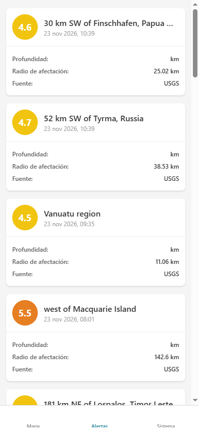
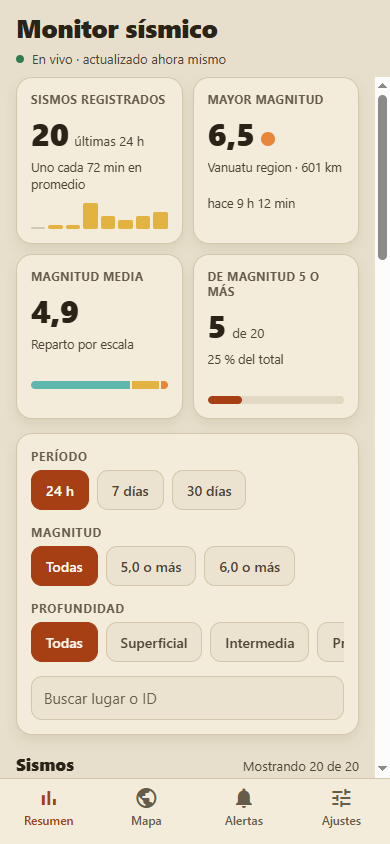
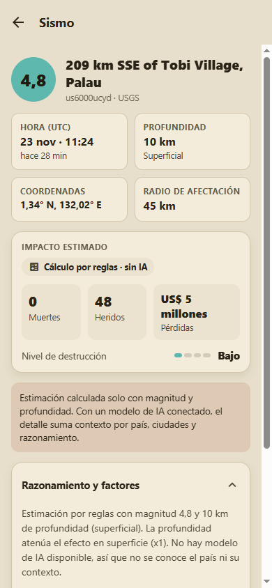
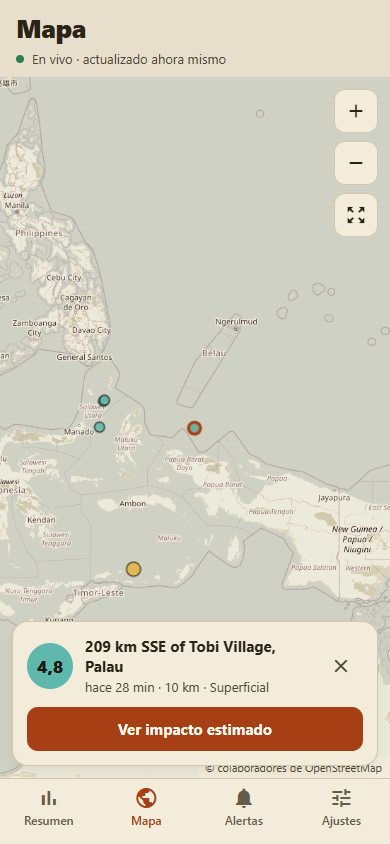
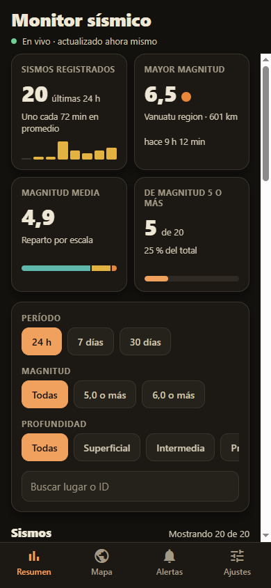
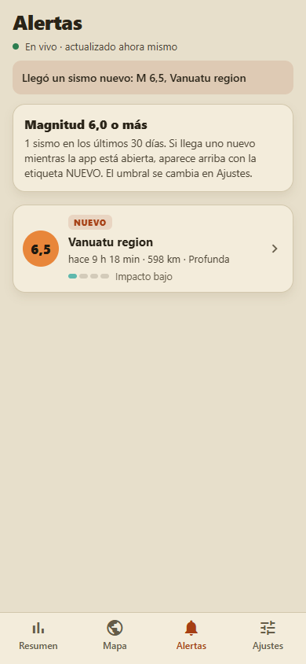
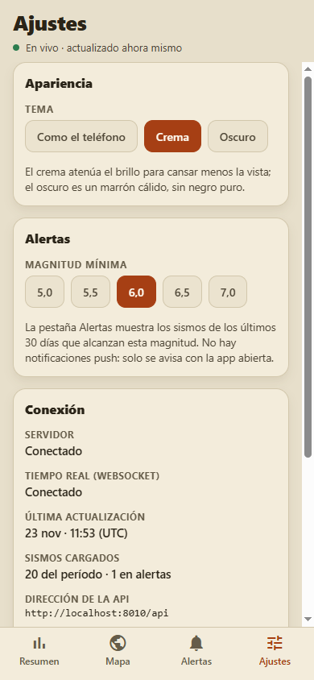

# Seismic monitor: phone client (Expo)

The phone client of the seismic monitor: the same USGS earthquakes and impact estimates as the web interface, in an **Expo 54** app (React Native 0.81, `expo-router`, TypeScript) with the same cream and dark themes. It talks to the FastAPI backend of this repository over REST and a WebSocket.

> Español: lo mismo, con los pasos para correrlo en [DEPLOYMENT.md](../DEPLOYMENT.md) y el contexto en [README.es.md](../README.es.md).

| Before | After |
|---|---|
|  |  |

The old client showed «Profundidad: km» with nothing in it (it read `profundidad_km`; the API sends `profundidad`), counted «Total de eventos: 1», pointed at a LAN address written in the code and a WebSocket path (`/api/ws`) the backend does not serve. It did not even start in the browser: `react-native-maps` has no web build.

## Screens

| | | |
|---|---|---|
|  |  |  |
|  |  |  |

- **Resumen**: four cards (quakes, largest, mean magnitude, magnitude 5 or more), period / magnitude / depth chips, search, and the list of quakes. Pull to refresh.
- **Mapa**: the quakes coloured by the magnitude scale; tap one for a sheet with its summary and a link to its detail.
- **Alertas**: quakes at or above a magnitude threshold (6.0 by default) over the last 30 days. If one arrives while the app is open, it shows at the top with a «NUEVO» tag.
- **Detalle**: facts, estimated deaths, injured and losses, destruction level, and whether the estimate came from rules or from the AI.
- **Ajustes**: theme (follow the phone, cream, dark), the alert threshold, connection status and the addresses in use.

## Run it

Requirements: Node 22.6 or newer, and the backend running (`docker compose up -d db backend` from the repository root).

```powershell
cd mobile
npm install
```

**In the browser** (the quickest way to look at it, no phone needed):

```powershell
$env:EXPO_PUBLIC_API_URL = "http://localhost:8000/api"
npx expo start --web --port 8081
```

The backend must allow the origin `http://localhost:8081`; it is in `CORS_ORIGINS` of `.env.example`.

**On a phone** with [Expo Go](https://expo.dev/go): same Wi-Fi as the PC, then

```powershell
npx expo start --lan
```

and scan the QR code. **On the Android emulator**: `npx expo start --android`.

### How the app finds the API

`lib/direccion.ts` decides it with a pure function (tested), in this order:

| Situation | Address |
|---|---|
| `EXPO_PUBLIC_API_URL` is set | that one (the WebSocket is derived from it: same host, path `/ws`) |
| Web | `http://localhost:8000/api` |
| A phone with Expo Go | the PC that serves the app, port 8000 |
| Android emulator, no Expo host | `http://10.0.2.2:8000/api` |
| iOS simulator, no Expo host | `http://localhost:8000/api` |

**Ajustes → Conexión** shows the address the app is using.

## Structure

| Path | What it is |
|---|---|
| `app/` | `expo-router` screens: `(tabs)/` (Resumen, Mapa, Alertas, Ajustes) and `evento/[id].tsx` (detail) |
| `components/` | Badges, chips, KPI cards, rows, loading and error states; `SeismicMap.tsx` (native map) and `SeismicMap.web.tsx` (Leaflet, for the browser) |
| `constants/paleta.ts` | The cream and dark palette and the magnitude scale, the same values as the web's `globals.css` |
| `lib/seismic.ts`, `lib/format.ts`, `lib/websocket.ts` | **Copies** of the web's files (same pure logic, same tests). Change one, change the other |
| `lib/datos.tsx`, `lib/ajustes.tsx` | The data shared by the screens (period, quakes, alerts, WebSocket status) and the saved settings |
| `lib/direccion.ts`, `lib/config.ts` | Where the backend is |
| `tests/` | `node:test` tests |

Why copies and not a shared package: Metro does not resolve files outside `mobile/` without extra configuration, and a monorepo for two files would be more machinery than the problem needs.

## Checks

```powershell
npm test               # 30 tests: the logic shared with the web, the address resolver, the settings
npx tsc --noEmit       # TypeScript
npx expo export --platform android   # also ios and web: proves it compiles for each one
```

With the app running in the browser and the backend up, `npm run movil --prefix ../tools/video` (after `npm install --prefix ../tools/video`) walks every screen in both themes at 390×844, tries the filters and the navigation, and measures the contrast of every visible text. In the last run: 770 texts, 0 below 4.5:1, 0 console errors. The app icons are generated by `tools/capturas/generar_iconos.js`.

## Honest limits

- **It was checked in a browser, not on a phone.** The browser build (`react-native-web`) shows the layout, the data, the navigation and the themes. It cannot show the native map, the touch gestures, the haptics, the feel of pull-to-refresh, the safe areas of a phone with a notch, or performance with 500 quakes. The three builds (Android, iOS, web) do compile; nobody has opened it on a device yet.
- **The map you see in the browser is not the phone's map.** On the phone `react-native-maps` draws the quakes as pins tinted by magnitude (Google Maps on Android, Apple Maps on iOS); in the browser Leaflet draws circles. The native map has not been displayed. A standalone Android build needs a Google Maps API key; Expo Go brings its own.
- **No push notifications.** Alerts appear only while the app is open (over the WebSocket); push needs a native build and a token service.
- **The live notification was checked once, on the web build.** A quake deleted from the local database was re-ingested by the poller and the app showed «Llegó un sismo nuevo» after about two minutes. The same code runs on the phone, but it has not been observed there.
- **The estimates are not official data** (see the root README, which also compares the AI estimate with the rules). The detail screen shows «Análisis con IA» or «Cálculo por reglas · sin IA» depending on where the estimate came from.
- **The interface is in Spanish only**, and place names come from the USGS in English.
